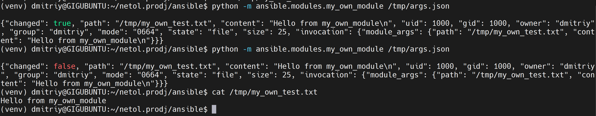
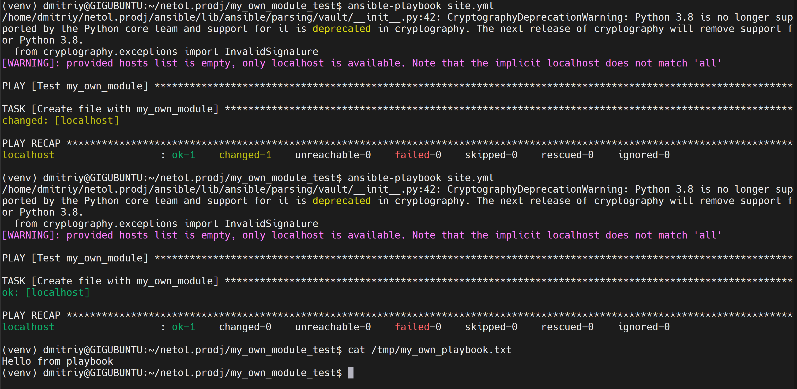
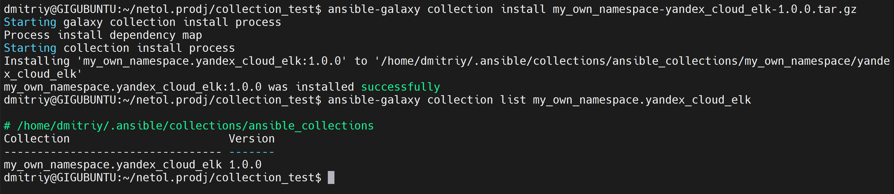
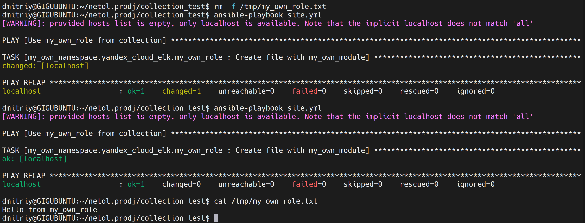

# Домашнее задание к занятию 6 «Создание собственных модулей»

## Ссылки

- Collection: [my_own_collection](https://github.com/S1ugger96/my_own_collection)
- Архив: [my_own_namespace-yandex_cloud_elk-1.0.0.tar.gz](https://github.com/S1ugger96/my_own_collection/blob/main/my_own_namespace-yandex_cloud_elk-1.0.0.tar.gz)
- Тег 1.0.0: [1.0.0](https://github.com/S1ugger96/my_own_collection/tree/1.0.0)
- Код модуля: [my_own_module.py](https://github.com/S1ugger96/my_own_collection/blob/main/plugins/modules/my_own_module.py)

## Подготовка

На машине Ubuntu 20.04 с Python 3.8, а текущая ветка ansible (devel) требует Python 3.13+. Поэтому взял ветку `stable-2.13`, она работает с 3.8.

```bash
git clone --depth 1 -b stable-2.13 https://github.com/ansible/ansible.git
cd ansible
python3 -m venv venv
. venv/bin/activate
pip install -r requirements.txt
. hacking/env-setup
```

## Шаги 1-3. Модуль

Создал `lib/ansible/modules/my_own_module.py`. Параметры:
- `path` - путь к файлу (обязательный)
- `content` - текст, который записать в файл

Если файл уже есть и текст в нём такой же - модуль ничего не делает (`changed: false`). Иначе создаёт файл и возвращает `changed: true`. Check mode поддерживается.

## Шаг 4. Проверка модуля локально

```bash
python -m ansible.modules.my_own_module /tmp/args.json
```

Первый запуск - `changed: true`, второй - `changed: false`.



## Шаги 5-6. Playbook и идемпотентность

```yaml
---
- name: Test my_own_module
  hosts: localhost
  gather_facts: false
  tasks:
    - name: Create file with my_own_module
      my_own_module:
        path: /tmp/my_own_playbook.txt
        content: "Hello from playbook\n"
```

Первый прогон - `changed=1`, второй - `changed=0`.



## Шаги 7-11. Collection и роль

Вышел из venv и создал collection:

```bash
ansible-galaxy collection init my_own_namespace.yandex_cloud_elk
```

Модуль перенёс в `plugins/modules/`, playbook переделал в роль `my_own_role`.

`roles/my_own_role/defaults/main.yml`:

```yaml
---
my_own_role_path: /tmp/my_own_role.txt
my_own_role_content: "Hello from my_own_role\n"
```

`roles/my_own_role/tasks/main.yml`:

```yaml
---
- name: Create file with my_own_module
  my_own_namespace.yandex_cloud_elk.my_own_module:
    path: "{{ my_own_role_path }}"
    content: "{{ my_own_role_content }}"
```

Playbook для роли:

```yaml
---
- name: Use my_own_role from collection
  hosts: localhost
  gather_facts: false
  roles:
    - my_own_namespace.yandex_cloud_elk.my_own_role
```

Структура collection:

```
yandex_cloud_elk/
├── galaxy.yml
├── README.md
├── playbook/site.yml
├── plugins/modules/my_own_module.py
└── roles/my_own_role/
    ├── README.md
    ├── defaults/main.yml
    └── tasks/main.yml
```

## Шаг 12. Документация и тег

Заполнил `galaxy.yml`, README коллекции и роли, запушил в репозиторий и поставил тег `1.0.0`.

## Шаги 13-15. Сборка и установка

```bash
ansible-galaxy collection build
mkdir ~/netol.prodj/collection_test
cp playbook/site.yml ~/netol.prodj/collection_test/
cp my_own_namespace-yandex_cloud_elk-1.0.0.tar.gz ~/netol.prodj/collection_test/
cd ~/netol.prodj/collection_test
ansible-galaxy collection install my_own_namespace-yandex_cloud_elk-1.0.0.tar.gz
```



## Шаг 16. Запуск playbook

```bash
ansible-playbook site.yml
```

Роль из установленной collection отработала, файл создан с текстом из defaults. Повторный запуск - `changed=0`.


